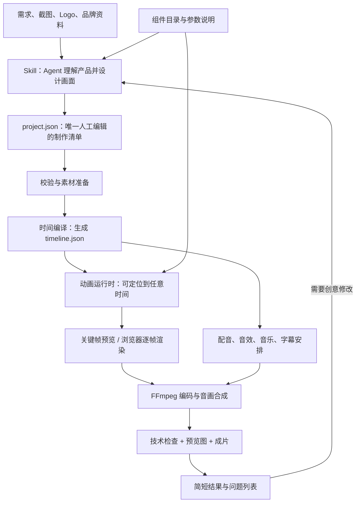

# Takecraft：可复用的视频制作工具链设计

日期：2026-10-22。状态：用户已授权按本架构建立项目并制定实施计划；已完成一次独立的可实施性检查。当前仓库已初始化，产品功能尚未实现。

Takecraft 是暂用项目名。工程位于 `/Users/plonguo/Git/takecraft`；本文件是正式架构文档，实施计划见 [M1 实施计划](2026-10-22-m1-implementation.md)。

## 1. 这套东西做什么

用户描述想要的短片，Agent 负责创意和制作清单，程序把清单变成可预览、可修改的视频。

可以把它理解为厨房：Agent 是设计菜单的厨师，制作清单是订单，动画组件是准备好的食材，工具链是固定设备。每份订单无需重新造烤箱，但新菜仍然可以增加新的做法。

用户已经明确的要求：

- 做一个能通过 Skill 使用的视频制作工具。
- 学习 onetake 的完整链路，包括动画、出片等实际工具，而不只写提示词。
- 先理清架构，再开始实现。
- 把可重复的流程代码化，减少每次让 coding agent 从零写代码带来的 token 消耗。

当前架构的实现选择（由助手提出，用户随后授权建立项目）：本地优先；TypeScript 单工程；先覆盖 15 秒二维产品动效片；保留扩展能力；独立实现代码和素材；暂不建设在线编辑器、账号系统或云任务集群。

这里的 Agent 是能读取文件、调用工具、修改代码的 AI 助手；token 是模型处理文字时使用的计量单位。节省 token 不等于节省渲染时间，两者分别测量。

## 2. 架构选择

| 方案 | 每条视频需要 Agent 做什么 | 优点 | 代价 |
| --- | --- | --- | --- |
| 每次写完整动画网页 | 设计、编写全部页面与动画、调试整个工程 | 自由度高 | 重复代码多，容易反复修错 |
| 固定整片模板 | 选模板，替换文案和图片 | 便宜、稳定 | 风格和故事易同质化，很难做自然衔接 |
| 制作清单 + 可组合组件 + 定制扩展 | 设计画面，选组件，填写参数；必要时新增组件 | 能复用工具和动作，也保留新创意 | 初期要建立组件契约、校验器和渲染器 |

推荐第三种。自动化固定的生产步骤，保留创意的选择权。不要让组件库重新变成一组只能依次播放的页面。

## 3. 从需求到成片



首次创作和修改需要 Agent。清单确定后，素材处理、时间计算、渲染、合成、技术检查、断点恢复不需要语言模型参与。工具内部不再偷偷调用另一个 coding agent。

### 模块职责

| 模块 | 输入 | 输出 | Agent 是否参与 |
| --- | --- | --- | --- |
| 创意与编排 | 用户需求、素材摘要、必要的参考图 | 概念、文案、project.json | 是 |
| 素材准备 | 本地图片、字体、音频引用 | 标准化素材、尺寸/时长/来源清单 | 普通处理不需要；理解内容时需要 |
| 校验与编译 | project.json、组件定义、素材测量结果 | timeline.json、明确的错误位置 | 不需要 |
| 动画运行时 | timeline.json、组件和素材 | 指定时间的画面及元素测量结果 | 不需要 |
| 声音处理 | 音效事件、音乐、可选配音 | 混音 WAV、字幕文件 | 不需要 coding agent；生成配音可调用已配置服务 |
| 渲染和编码 | 动画、声音、输出规格 | MP4、预览图 | 不需要 |
| 技术检查 | 清单、元素测量结果、成片 | 结构化检查报告 | 不需要 |
| 审美判断和修订 | 预览图、成片、问题摘要 | 对清单或组件的定向修改 | Agent / 人 |

FFmpeg 是处理音视频的程序；Playwright 是控制浏览器的工具；Chromium 是实际绘制画面的浏览器。

## 4. 制作清单是接口，不是新的编程语言

`project.json` 使用 JSON：一种可以被程序稳定读写的结构化文本。它是唯一人工编辑的制作事实来源。`timeline.json` 是根据它计算出的文件，不允许 Agent 单独修改，否则预览、渲染和后续修改会不一致。

制作清单第一版包含：

| 字段 | 作用 |
| --- | --- |
| schemaVersion / id | 格式版本、作品标识 |
| canvas / fps / duration | 画布、帧率、目标时长 |
| theme | 字体、背景色、文字色、强调色 |
| assets | 图片、Logo、字体、可选音频；引用本地资产标识 |
| actors | 长期存在的画面对象，每个对象有稳定 id、组件类型和参数 |
| tracks | 对象属性随时间如何改变，如位置、大小、透明度、文字状态 |
| camera | 全局镜头的位置、缩放和旋转轨迹 |
| beats / carries | 内容节拍及交接处由哪个对象延续；用于创作与检查 |
| audio / captions | 音效事件、音乐、可选旁白与字幕 |
| checks | 哪些时间段中哪些对象必须可见、哪些文本必须检查溢出 |

“节拍”指一个内容动作，例如出现问题、展示操作、给出结果，不必对应镜头切换。“轨道”指一个属性随时间变化的记录。“编译”指把易于编辑的清单转换成程序可直接执行的具体时间和数值。

第一版不在 JSON 中放任意 JavaScript、Shell 命令或数学表达式。不做万能动画语言。常见动作使用命名预设和参数，高自由度效果用真正的组件代码实现。

Agent 通常从预设初始化一个有效清单，只改文案、素材、动作、布局和节奏，不从空白写一大份逐帧数值。比如“让窗口在 3 秒开始展开，持续 0.8 秒”，由动作预设展开成具体属性轨道；布局先支持中心/边缘锚点与少量布局规则，不建设通用约束求解器。Agent 不必手写每帧坐标。组件 schema 是参数格式规则；使用 Zod 定义规则并导出 JSON Schema，让工具校验和 Agent 获取的说明来自同一来源。

### 一镜到底的对象模型

舞台是一张持续存在的画布，物体和镜头有独立轨道。节拍只划分叙事，不销毁画面对象。

例如 `main-surface` 从输入框变为窗口，再变为手机外壳时，仍然使用同一个 id；尺寸、位置、圆角和内部内容在时间轴上变化。不能用“第 1 段播放完，把全部东西隐藏，然后加载第 2 段”作为默认实现。

同一属性在同一时间不允许两个互相冲突的动作；编译时返回冲突路径。没有动画覆盖的属性按明确的初始值和最近关键帧值计算。复杂物理运动先按固定步长计算并保存，再按时间采样。

## 5. 组件库决定复用的质量

第一版先实现以下基础对象和动作，具体数量以验收用例需要为准，不为凑数建库：

- 对象：文字块、图片、可变形圆角容器、产品窗口、光标、简单图形。
- 动作：渐显、位移、缩放、弹簧落位、打字、容器形变。
- 镜头：平移、缩放、静止保持。
- 衔接：同一容器从输入框展开为窗口；镜头推进持续存在的对象；已有对象收拢成结尾标志。
- 起步配方：15 秒产品介绍。配方是一份可编辑的制作清单，不是强制所有视频遵循的固定故事。

每个组件必须提供：稳定类型名、版本、参数 schema、简短说明、一个参数示例、预览图、边界测量方法，以及初始化/按时间更新/释放资源的生命周期。

所有随时间变化的状态都由当前时间决定。禁止依赖真实时钟、无种子随机数或前一帧的播放顺序。相同环境和输入下，先渲染 10 秒再渲染 2 秒，应与直接渲染 2 秒一致。跨浏览器版本或设备不承诺像素完全相同。

### 定制扩展

当组件库不能表达用户的创意，Agent 可以新增本地 TypeScript 组件，而不是改写渲染器。新增组件需要自己的参数说明、预览样例和确定性验证。

项目专用组件先留在该项目，证明能复用后再进入通用库。不会把每次偶然产生的代码自动加入全局 Skill。

第一版只运行本机可信代码，不提供任意远程插件下载执行机制。自定义组件是本地代码扩展，不宣称已实现安全沙箱。

## 6. 工具接口与省 token 的机制

CLI 是命令行工具，Agent 可像运行其他程序一样调用。下面是目标接口，不是已经存在的命令：

```text
takecraft doctor
takecraft catalog --summary
takecraft describe morph-surface
takecraft init ./films/demo --recipe product-launch
takecraft validate ./films/demo/project.json --json
takecraft preview ./films/demo/project.json
takecraft build ./films/demo/project.json --profile draft --json
takecraft build ./films/demo/project.json --profile final --json
takecraft status ./films/demo --json
```

`build` 是一次调用的完整生产入口：校验 → 准备素材 → 解析声音时长 → 编译时间线 → 预检 → 渲染 → 混音/编码 → 成片检查。`preview` 负责浏览器预览和指定时间/关键时间的预览图。最终档在 M2 实现前返回明确的未支持错误，不把草稿文件当作最终档返回。

Skill 只保留任务边界、目录发现方法、清单编辑原则、运行命令和错误处理方法。完整参数说明从 `describe` 按需读取，不在每次调用时加载所有源码、完整样例和全部参考文档。

| 省 token 的位置 | 具体做法 |
| --- | --- |
| 不重复造工具 | 渲染、字幕导出、声音混合、检查由固定程序负责 |
| 不重复读工具源码 | catalog 返回短摘要，describe 只返回选中组件的说明 |
| 不重复生成整片代码 | 编辑制作清单；特殊效果才写组件 |
| 不重复消化日志 | --json 返回阶段、错误代码、字段位置、建议动作、产物路径 |
| 不重复探测素材 | 保存尺寸、时长、字体信息及内容摘要，可复用的视觉摘要与文件哈希绑定 |
| 不重新跑整条链路 | 修改音乐只重做声音和最终合成；静态文案改变不重新生成旁白 |
| 不让 Agent 轮询每一帧 | CLI 自己执行长任务、写进度、管理浏览器与重试 |
| 不让失败陷入无限对话 | 机械故障有限重试；创意或清单修复最多自动尝试两轮，仍失败就报告阻塞 |

哈希是根据文件内容计算的指纹，用来判断文件是否真的变化。视觉摘要不能只绑定路径，否则同路径换图会复用旧信息。

省 token 的效果目前没有实测，不承诺固定百分比。验证时分别记录 Agent 实际用量（宿主可提供时）、模型调用/修复轮数、工具返回文本量、处理耗时、缓存命中；没有真实 token 数据时明确报告“未测量”，不把字数当成实际账单。

## 7. 渲染、声音和检查

### 渲染

采用 TypeScript + 浏览器 DOM/SVG/Canvas 的二维实现。DOM 是浏览器中的页面元素树，SVG 是可缩放图形，Canvas 是用代码绘制的画布。第一版优先 DOM/SVG，复杂效果按需用 Canvas。

运行时提供 `ready()`、`seek(timeSeconds)`、`inspect(timeSeconds)`。后者返回元素可见性、边界和文字溢出信息。浏览器加载完成、字体就绪、图片解码完成后才能截图。

Node 进程通过 Playwright 调用运行时，再截取每一帧；FFmpeg 将帧序列编码为 H.264 视频并合入 AAC 音频。资源通过只监听本机的静态服务提供，避免 `file://` 的模块和资源加载差异。渲染期间不下载远程素材。

草稿默认 1920×1080、30 fps；最终档目标 3840×2160、60 fps。先验证同一时间线在不同输出尺度下位置和文字布局一致，再交付最终档。默认只生成草稿，用户明确选择最终档时输出最终档。

运动模糊是快速运动在曝光期间留下的拖影。完整产品通过一个输出帧内多次时间采样，在正确的颜色空间中平均实现；第一里程碑不包含该能力，报告必须写清 sharp/blurred，不能把普通模糊滤镜标成等价实现。多浏览器并行和高级模糊属于后续性能/画质工作。

### 声音与字幕

- 第一里程碑支持用户提供的音乐文件、旁白音频、定时字幕，以及程序生成的基础点击/气流/落地音效；按事件放到时间线，淡入淡出、混音、避免超出片长。
- 没有提供音乐时使用基础音效，不自动下载来源不明的音乐。没有要求旁白时不生成旁白，报告显示“未请求”，而不是伪造配音已完成。
- 第二里程碑增加 TTS（把文字变成语音）的 provider 接口，并实际接通至少一个服务或本地模型。声音文本、语言、音色、模型/版本、参数都进入缓存键。选择哪个 provider 在该阶段结合音质、费用、中文支持确定；当前不预设用户已经拥有付费服务。
- 配音先生成并测量时长，再编译相关时间点。第一里程碑中音频超出目标时段直接报错；后续只能通过明确的延长画面、修改文案或重新生成语速解决，不静默截断旁白。
- 第一里程碑导出用户给定时间的 SRT 字幕；不宣称逐词对齐。第二里程碑增加语音识别/强制对齐得到词级时间，再生成字幕和语义锚点。

“完整链路”指支持的输入能一路生成、检查并交付视频，不代表第一里程碑同时完成全部可选模块。旁白生成、三维和高级镜头在里程碑中明确分期。

### 技术检查与审美检查分开

程序负责：清单格式、资源缺失、字体加载、时间越界、属性冲突、文字溢出、声明必须可见的对象出画、确定性错误、帧数/尺寸/时长、音频峰值和完整解码。

连续性通过稳定对象 id、跨节拍存活和位置/尺寸连续性给出诊断。第一里程碑不推出一个未经真实样本验证的“审美总分”。节拍长度一致、留白偏少等只作为建议，不能把某种风格写成所有视频的硬规则。

默认产物检查失败时 build 返回失败并保留可诊断文件，不把失败版本当成功成片。审美仍由 Agent 看预览图、必要时查看成片，再由人评价；自动技术检查通过不代表画面一定好看。

## 8. 缓存、修改和任务状态

第一里程碑只做阶段级缓存，不做复杂的任意片段增量渲染：

| 改动 | 可以复用 | 必须重做 |
| --- | --- | --- |
| 只换音乐，时间线未改变 | 素材、时间线、无声视频 | 混音、最终合成、成片检查 |
| 只改画面文字，不涉及配音/时间 | 独立的声音产物 | 布局校验、时间线、全部画面、合成、成片检查 |
| 只改编码质量，尺寸/帧率/模糊不变 | 保留的无损画面帧和声音 | 编码、成片检查；帧已清理则重渲染 |
| 改分辨率、帧率、字体、镜头、动画组件 | 无关素材、未变的声音 | 相关预检、画面、合成、成片检查 |
| 改旁白 | 无关素材 | 旁白和对齐；必要时重算时间线并重渲染画面 |

画面缓存键包括：归一化画面清单、素材内容、组件/运行时版本、渲染配置、浏览器版本、字体。声音缓存键独立。最终成片由无声视频和混音共同决定。每阶段验证产物存在且完整，不能只有状态文件写了 success 就复用。

不把同一连续镜头硬切成若干 MP4 再拼接，以免转场、相机和音频跨边界出错。后续要做局部帧缓存，必须计算整个依赖影响区间，并覆盖运动模糊的采样邻域；不能只根据某段文案所在节拍判断。

每次运行有唯一目录和状态文件，记录清单指纹、阶段状态、退出码、耗时和产物。原子写入成功标记；同一作品同时 build 时通过文件锁拒绝竞争；失败和中断保留状态及日志。输出采用运行编号，不覆盖上一次成功交付。

浏览器退出、短暂文件占用等机械问题最多重试两次；无效清单、缺失素材、持续脚本异常直接报告。恢复任务必须重新确认输入和版本指纹一致，否则只复用仍有效的独立阶段。

## 9. 工程组织

建议单一 pnpm 工程，Node.js 22 LTS、TypeScript；初期不拆成多个独立发布包。具体兼容依赖版本由实现时验证并写入锁文件，不依赖浮动 latest。

```text
takecraft/
  src/
    cli/                  命令入口和紧凑 JSON 输出
    project/              schema、素材清单、校验、时间编译
    runtime/              舞台、时间采样、镜头、测量
    components/           对象、动作和参数目录
    pipeline/             阶段编排、缓存、状态、恢复
    render/               浏览器管理、截图、编码
    audio/                音效、混音、字幕、后续 TTS 适配器
    quality/              技术检查和诊断报告
  recipes/                少量可编辑起步清单
  skills/takecraft/        短 SKILL.md、必要的按需说明
  examples/               自有素材的示例作品
  tests/                  契约、确定性、缓存和端到端测试
  docs/                   架构、实现计划、使用说明
```

动画和编排尽量共用 TypeScript，减少 Python/Node 双套环境。FFmpeg 是外部依赖。以后某个本地语音模型只能用 Python 时，通过独立适配器接入，不让整个项目改成两套主运行时。

组件目录、schema、渲染器和 Skill 都在同一工程维护。CLI 先是唯一工具接口；MCP（让 AI 助手用统一协议调用工具的方式）可以以后作为薄包装，避免一开始同时维护两套业务逻辑。

本机只读探测结果：Node 22.22.0、pnpm 10.28.2、FFmpeg/ffprobe 已存在，系统安装了 Google Chrome。Playwright 的受管浏览器缓存尚不存在；后续 doctor 必须验证可用浏览器，不能假设此前 gstack 的启动失败已经解决。

## 10. 分期与可验收结果

### M1：独立可运行的二维闭环

做出项目 schema、基础组件、三种衔接、时间运行时、素材检查、浏览器渲染、声音混合、SRT 输出、预览图、技术检查、阶段缓存、任务状态和短 Skill。

验收输入：一份有效的 15 秒产品介绍清单、中文文案、产品截图/Logo，以及可选的用户音频。演示使用自己制作并标明的虚构产品素材，不假冒真实客户素材。

验收输出：1080p30 MP4、预览图、可重开的项目、状态与质量报告；有字幕输入时输出 SRT；有音频输入或音效事件时产生正确的音轨。

必须实际验证：

1. 不需要 Agent 写新代码，一条 build 命令完成已有配方的视频。
2. 替换名称、颜色、截图后仍能生成第二条视频。
3. 相同输入和运行环境，乱序 seek 与顺序 seek 得到相同帧。
4. 改音乐不重新截图；改文字不会错误命中旧画面；相同路径换图不会复用旧素材结果。
5. 清单错误、缺图、中文字体缺失、文字溢出、音频超时能够明确失败。
6. 中断恢复不会误用旧版本文件；两次并发构建不会互相覆盖。
7. ffprobe 检查视频规格，FFmpeg 完整解码成功，关键帧实际目检；不能只凭 TypeScript 编译通过宣布完成。
8. 可选声音/字幕未提供时报告未请求；未实现功能明确列出，不伪造完成。

M1 不包含：自动生成旁白、逐词字幕对齐、自动复刻任意 App 界面、三维、运动模糊、多浏览器并行、4K60 交付、在线编辑器。它交付的是上述二维用例的完整闭环。

### M2：补齐 onetake 风格所需的画质和声音能力

实现多次时间采样的运动模糊、4K60、受控并行渲染、至少一个可用 TTS provider、逐词字幕/语义对齐、更多镜头与衔接、自定义组件完整工作流。

以同一虚构产品的升级样片、带中文旁白的样片以及一次局部修订验证，不以新增函数数量作为完成标准。

### M3：扩展创作范围

根据真实需求增加界面复刻辅助、参考片分析、Three.js 三维场景、更多可复用配方和素材来源适配。此阶段范围依据 M1/M2 的真实失败调整，不预先建设大型插件市场或分布式系统。

## 11. 关键取舍与风险

| 风险 | 处理 |
| --- | --- |
| 组件过少，Agent 总是退回生成整页代码 | 记录缺失能力；先补复用组件，再恢复清单驱动 |
| 清单变成另一种复杂编程语言 | 严格限制声明能力，复杂逻辑放进组件 |
| 模板固化审美 | 复用对象/动作和衔接方式，配方只作起点 |
| 配音时长改变导致音画错位 | 声音先准备测量，时间线后编译，显式定义溢出处理 |
| 缓存省时间却输出旧画面 | 使用内容指纹、组件版本和渲染环境；无法证明有效就重做 |
| 一键意味着无限自动修复 | 限定重试次数，失败保留可审查结果 |
| 新工具比原项目更复杂 | 先做单机、单工程和阶段缓存，不引入队列服务或数据库 |
| 误把技术分数当审美评分 | 技术检查与人的评价分开；评分只从真实案例中建立 |

独立实现核心链路和案例，不把 onetake 的受限代码、模板、说明文字改名后当作自己的商业产品。这里只把公开实现作为架构研究来源。

## 12. 阅读依据与自检

- onetake 制作协议：https://github.com/feitangyuan/onetake/blob/main/SKILL.md
- onetake 渲染流程：https://github.com/feitangyuan/onetake/blob/main/scripts/render.py
- onetake 元素/连续性测量：https://github.com/feitangyuan/onetake/blob/main/scripts/probe.py
- Playwright 浏览器中执行函数：https://playwright.dev/docs/evaluating
- Playwright 截图：https://playwright.dev/docs/screenshots
- FFmpeg 音视频处理：https://ffmpeg.org/ffmpeg.html
- Zod 导出 JSON Schema：https://zod.dev/json-schema

架构自检：

1. 已有清单再次出片，哪些步骤还需要语言模型？如果固定阶段仍需它重新写脚本，工具化就没有完成。
2. 把音乐换掉，为什么不应该重新截图？因为声音和画面的依赖分开，时间线未变时画面可以复用。
3. 新创意超出组件库时怎么办？新增遵守运行时契约的组件，而不是把整个出片链路推翻。
4. 程序能保证“好看”吗？能检查可观测的技术条件，不能替代对创意和表达的判断。
