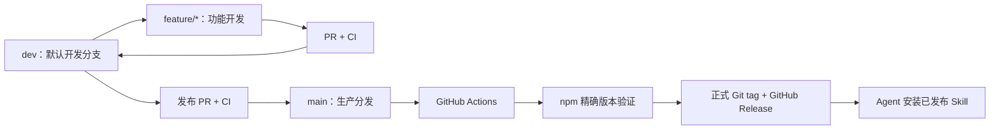

# Takecraft：以 Coding Agent 为主要入口的安装与分发方案

日期：2026-10-24。状态：Codex/macOS 首版分发已完成至 v0.2.3，dev/main 自动发布已验证。下一轮动作/风格迭代采用 v0.3.0。

## 目标与已确定要求

让用户把一段安装请求交给 Coding Agent（能读文件、执行命令的编程助手），由 Agent 完成安装和验证，随后直接描述视频需求。用户也能自己通过 CLI（命令行工具）操作。

可以把 Skill 看作设备说明书，Takecraft 引擎看作真正工作的设备，skills.sh 和 npm 是分发这两部分的渠道。说明书安装成功，不等于设备及运行环境已经准备好；我们的工作是把后半段变成固定工具流程。

用户已确定：Agent 优先、保留手动 CLI、采用 skills.sh 方向、安装尽量简单、完成本次分发后再开发 v1。首版不适配全部平台；dev 为默认开发分支，feature 从 dev 创建并先合入 dev，验证后 dev 合入 main 触发生产分发。更新提醒暂缓。实现者建议首版只完整验收 Codex + macOS，其他 Agent 和用户操作系统后置。用户现已授权按此设计实施。

## 调研结论

- 正确命令为 `npx skills add`，不是 `npx skill add`。Vercel 的 skills CLI 支持 Codex、Claude Code、Cursor 等 Agent，并处理各自的 Skill 安装位置；默认项目安装，`-g` 表示用户级安装。[命令文档](https://github.com/vercel-labs/skills/blob/main/docs/commands.md)、[Agent 支持](https://github.com/vercel-labs/skills/blob/main/docs/agents.md)。
- Skill 可在公开 GitHub 仓库的 `skills/<name>/SKILL.md` 中维护；不必另外上传视频引擎到 skills.sh。官方 FAQ 说明目录根据安装遥测收录，不能承诺即时展示或排名。[发现规则](https://github.com/vercel-labs/skills/blob/main/docs/creating-skills.md)、[FAQ](https://skills.sh/docs/faq)。
- `skills` 本身也是 npm 包，能分发 Skill，所以“包管理器只能装引擎，Skill 必须手动拷贝”不成立。普通安装 Takecraft npm 包不会自动让所有 Agent 识别其 Skill，仍需要明确安装步骤。
- skills 提供从 npm 包同步 Skill 的实验功能，但本次不依赖它；采用正式的 `skills add`。[官方 README](https://github.com/vercel-labs/skills)。
- 插件商店可以后续扩展：Claude Code 支持自建 marketplace（插件目录），也提供公共目录提交路径；OpenAI 官方文档提供 ChatGPT/Codex 插件提交、检查和审核流程。本次不把商店审核作为发布前提，也不额外引入服务端。[Claude 文档](https://code.claude.com/docs/en/plugin-marketplaces)、[OpenAI 官方提交说明](https://developers.openai.com/plugins/deploy/submission)。

## 用户看到的入口

README 首先展示“复制给你的 Agent”，大意如下。此为目标文案，当前 v0.1.1 的 Skill 还不能按此完成全链路。

> 帮我安装 Takecraft，供当前 Coding Agent 跨项目使用。从 PlonGuo/takecraft 的最新正式 GitHub Release 取得发行 tag，通过 skills CLI 安装该 tag 下的 takecraft Skill；安装后读取它的安装说明，完成对应版本的视频工具和环境准备，验证可用，并告诉我如何开始制作视频。

首版固定面向 Codex。Agent 查询最新正式 Release 并核对 tag，再安装其对应 Skill；例如下面的 VERSION 要替换为实际已发布版本，不能直接复制执行：

```sh
npx --yes skills add https://github.com/PlonGuo/takecraft/tree/vVERSION/skills/takecraft --skill takecraft -a codex -g -y
```

默认跨项目使用（`-g`）；首版优先验证这一条路径，项目级使用仍可依赖 skills CLI 自身能力，但不新增 Takecraft 专用配置界面。Claude Code、Cursor 等不作为本轮验收要求。不能在默认分支改成 dev 后继续推荐无版本的 `skills add PlonGuo/takecraft`；安装/升级来源必须是已完成发布的 tag，不能是 dev，也不能把正在发布中的 main 当作已发布版本。

首版使用 skills CLI 的跨 Agent 分发能力，但只保证 README/Release 中的固定 tag 安装入口。skills.sh 目录自动生成的安装按钮是否保留发行 ref，必须另行验证；若它只生成 owner/repo，不作为首版推荐入口，也不宣传目录直装已可用。后续需要目录直装时再解决稳定来源，不为了上榜新增仓库或分支体系。

安装 Skill 后，当前 Agent 显式读取安装后的 `SKILL.md` 并继续准备工具；不能假定宿主会在本轮自动刷新 Skill 列表。后续持久识别按各宿主行为验证，必要时明确提示新建会话；不把“文件已写入”说成“宿主已加载”。

手动 CLI 用户可以选择：

```sh
# 目标用法，包名和命令尚待实现/验证，不应现在执行
pnpm add -g <发布包名>@latest
takecraft setup
```

纯 CLI 用户无需 Skill。为缩小首版范围，暂不增加 `setup --agent` 和多 Agent 自动检测；需要 Codex Skill 时复用 README 的同一条安装请求及 skills CLI。后续再考虑封装更多安装快捷入口。

## 分工与实现方案

| 部分 | 职责 | 不承担的工作 |
| --- | --- | --- |
| GitHub + skills.sh | 提供轻量 Skill、安装说明和定位脚本 | 保存大型引擎依赖、视频、帧缓存 |
| npm 中的完整 Takecraft 包 | 已编译 CLI、渲染运行时、主题、动作、配方与必要资源 | 要求用户克隆仓库或安装开发依赖 |
| Skill 内的轻量入口 | 定位并启动对应版本引擎，传递参数、输出与退出码 | 动画算法、重新编写安装器 |
| `takecraft setup` | 准备可管理的运行依赖、检查并返回环境状态 | 暗中修改其他 Agent 配置、在制片时升级版本 |
| Agent | 理解需求、执行既定安装流程、处理需要用户决定的环境问题 | 每台机器临时手写安装脚本或修补引擎 |

### 1. 发布完整可运行的 npm 包

保留一个工程和一套动画实现。发布包使用编译后的 JavaScript，不依赖开发环境中的 `tsx`；纳入运行时、`recipes`、字体依赖、必要素材及 Skill 资源，显式限定发布文件。排除测试产物、demo MP4、日志和本机设置。验证 CLI 的可执行入口、文件权限和符号链接路径。

目前 `package.json` 为 `private: true`，未限定发布文件；`scripts/run.mjs` 依赖开发依赖 `tsx`。仅修改包可见性不足以完成分发。`init` 依赖包内配方、渲染器依赖浏览器入口、字体通过包依赖解析，这些都必须从实际安装包验证。

### 2. 让 Skill 独立于源码目录

当前 Skill 根据 SKILL.md 上两级寻找源码。这在 skills CLI 仅复制/链接 Skill 时会失效，必须移除这一假设。

建议 Skill 内保留一个只使用 Node 内置模块的小入口，以及声明准确 npm 包名、引擎版本和接口版本的清单。安装入口和日常制片都通过同一个入口调用工具。

首版优先复用 npm 的按版本执行机制，例如 `npm exec --yes --package=<包名>@<准确版本> -- takecraft ...`，避免把安装目录管理再实现一遍。缓存由包管理器管理；每次按包名和版本解析，不把 npm 临时缓存的绝对路径写死进 Skill。参数按数组传递，保留用户当前目录、进程退出码和中断信号。

首次执行可能下载包和依赖；缓存完整时可复用。缓存被清理后需要重新获取同版，不能因此偷偷换成 latest，也不能承诺在缓存缺失时仍可离线运行。自动化验收覆盖缓存完整/缺失、离线、全局存在不同版本的场景。即使同名全局工具存在，Skill 也不能误调错版本。

这条路径让 Agent 用户只需 Node/npm，无需先安装 pnpm；pnpm 仍作为工程开发工具与手动安装选项。

### 3. 环境准备要真正闭环

`setup` 返回机器可读结果：工具版本、检查项、缺少的依赖、修复步骤、是否需要宿主刷新。`doctor` 为只读检查；`setup` 可重复执行，已有可用依赖直接复用。

- Node 是执行 JavaScript 工具的环境，也是 npx 的前提。最新 skills 文档要求 Node >=22.20；规划将新分发入口基线统一为 >=22.20，发布前复核。缺少 Node 时，README 的纯文本安装指引供 Agent 先检查并引导准备，不能让未启动的 setup 自己安装 Node。
- 浏览器由工具检查；缺少时通过随包 Playwright 准备匹配版本，不要求用户猜浏览器路径。下载中断后可重试。
- FFmpeg/ffprobe 是编码和检查视频的外部程序。首版复用已安装程序；缺少时输出明确、适合当前系统的安装步骤，由 Agent 在安装任务授权范围内执行。首版针对 macOS 优先复用已存在的 Homebrew。没有包管理器或需要管理员权限时报告具体阻塞，不编造“安装完成”。
- 新分发路径首批只完整验收 macOS；Linux/Windows 用户环境适配后置。现有 Linux 代码保持，不把新安装流程宣传成已完成多系统验收。

成功标准是：一个安装请求由 Agent 带到可用状态，不让用户手动搬文件和猜命令；系统必须由用户完成的授权仍交还用户。

### 4. Skill 与工具如何保持配套

一个发行版本同时生成包版本和 Skill 版本清单，自动检查一致。Skill 指向明确的已发布 npm 版本；制作视频时不使用 `@latest`。包内带同版 Skill，但 Agent 的安装文件由 skills CLI 管理，避免两个安装器互相覆盖。

正式安装入口从最新已发布 GitHub Release 解析固定 tag，不跟随仓库默认分支。发布顺序调整为 dev 经 PR 合入 main → Actions 验证并打包 → 发布 npm 指定版本并真实下载验证 → 建立对应 tag 和正式 GitHub Release。main 可以暂时包含发布中的版本，但公开安装入口仍留在上一个完成的 Release。npm 已发布版本保持不变，修复发新版本。

用户主动更新时，Agent 重新查询最新正式 Release，并从新 tag 安装 Skill；入口读取新的准确引擎版本，随后准备并检查对应工具。固定 tag 安装不假定 `skills update` 会自动跳到另一 tag。两条下载链路不宣称跨服务原子更新；新引擎不可用时返回明确失败，不悄悄用不兼容旧引擎继续制片。旧版仍可通过原发行来源重新安装。

现有 curl 安装方式保留作兼容入口。本机开发 Skill 链接和旧安装器拥有的目录不能直接覆盖；迁移时检查来源、列出冲突并保留用户自定义内容。Skill 同名冲突在调用第三方安装器之前检查，不能用 `-y` 无条件覆盖。

## 分支与自动发布

把 dev 看作工作台，main 看作交付线。CI（持续集成）自动检查代码与安装包；CD（持续交付/部署）在检查通过后分发正式版本。用户要求的流程为：



PR 是 Pull Request，即可审阅的合并请求。实施时从当前已交付 main 创建 dev，再将 GitHub 默认分支改为 dev；不是把 main 重命名为 dev。现有已发布 tag 不变。

| 位置/事件 | 自动执行 | 是否正式发布 |
| --- | --- | --- |
| feature/* → dev 的 PR | 类型检查、测试、构建、安装包冒烟检查 | 否 |
| dev 合入受保护 PR | PR 快速 CI 已通过，不重复触发 push 测试 | 否 |
| dev → main 的发布 PR | 快速 CI、发行版本及 Skill 版本一致性检查 | 否 |
| main 合入后的 push | 针对实际 main 提交重新验证、打包、发布及下载检查 | 是，新版本通过检查时 |

### 最小工作流

- `.github/workflows/ci.yml`：PR 目标为 dev/main，运行快速检查；main Release 复用完整检查。v0.2.2 起取消 dev push 的重复全套。PR 检查没有发布权限。
- `.github/workflows/release.yml`：自动触发条件为 push 到 main；测试通过后才进入发布。手动重新运行只用于失败恢复，不改变正常的 main 触发入口。
- 本轮不添加 dev 的 npm 预览发布、Changesets 或根据提交描述推断版本等系统。Changesets 是管理待发布变更与版本号的工具；单包项目先采用发布前明确修改 package.json、变更记录和 Skill 版本清单即可。
- 保护 dev/main：通过 PR 合并并要求必要检查通过；main 正常只接收 dev 的发布合并，不能因 GitHub 默认分支改为 dev 而漏掉 main 的检查。单人项目不额外要求无法由本人完成的他人审批。
- dev → main 使用保留历史的 merge commit；发布后把 main 的合并历史同步回 dev，避免长期分叉。feature → dev 可使用 squash（将功能提交压为一个提交），但长期 dev/main 互相同步不用 squash。
- 发布工作流不自动修改源码版本号、向 main 提交生成文件或回写 Skill 清单，避免形成触发循环。版本在发布 PR 中确定。

### 版本、失败与重跑

每次 main push 都触发流程，但不是每次都新发 npm 包。发布相关代码或资源变化必须有新版本；如果只改非发行文档且版本未变，检查通过后明确跳过发布。该规则在发布 PR 检查中提前验证。

正式发布一次构建出的同一个安装包：完成打包及安装验收 → 上传 npm（暂用非 latest 的 pending 标签）→ 从 registry 下载准确版本进行检查 → 将 npm latest 指向该版 → 创建不可变版本 tag 和 GitHub Release。registry 指 npm 的包存储服务；latest/pending 是指向包版本的分发标签，不是 Git 分支。GitHub Release 完成前，Skill 安装请求仍取得上一正式 Release。

同一包的发布流程串行执行；不主动取消已经开始上传的发布。重新运行时，已存在 npm 版本必须验证来源提交和内容一致，不能简单吞掉“版本已存在”错误；已有 Git tag 也必须指向目标提交。验证一致才补做剩余步骤，否则明确失败。外部网络/API 故障应有有限重试；不删除已发布包、不移动已有版本 tag。

npm latest 和 GitHub 最新正式 Release 只能向更新的正式版本推进。若较新的版本已经发布，重跑旧任务只能补齐该旧版本缺失的 tag/Release 等产物，不能将最新指针退回旧版；补建旧 Release 时明确不设为 latest。验收包含“旧版部分失败 → 新版成功 → 旧版重跑”这一场景，不能只依赖并发锁。

npm 与 GitHub 的发布不能跨服务保证原子性。若 npm 已成功但 GitHub Release 未完成，保留失败状态并允许同一提交补发 Release，不能报告全流程成功。若 npm 下载验收失败，不推进 latest、不发布正式 Release；修复必须使用新版本号。

### 发布身份与权限

推荐 npm Trusted Publishing（可信发布）：npm 根据 GitHub Actions 的临时身份确认发布来源，采用 OIDC（开放身份连接协议），避免在仓库保存长期 npm 发布令牌。绑定 PlonGuo/takecraft、准确 workflow 文件名和 production 环境；production 仅允许 main，正常合入后自动运行，不另加人工部署审批。

发布身份需允许直接 `npm publish` 及更新分发标签；不要误配为必须人工批准的 stage-only 模式。仅发布 job 取得 `id-token: write`，创建 tag/Release 的步骤取得必要 GitHub 写权限。使用 GitHub 托管 runner 和符合 npm 可信发布要求的 Node/npm 版本；工程安装、测试和打包仍用 pnpm。

首次建立 npm 包及可信发布关联可能需要包拥有者完成一次设置；在实施时核实账号/包名、初始化路径后完成，不让用户在聊天里粘贴 token。规划时尚无 `.github/workflows` 或 dev；现均已实现，正式验证与 CI 分层结果见 [计划与进度](README.md)。

依据：[GitHub 工作流触发规则](https://docs.github.com/en/actions/reference/workflows-and-actions/workflow-syntax)、[npm 可信发布](https://docs.npmjs.com/trusted-publishers/)。

## 本轮不做与未来更新

不增加动画功能，不做 v1，不建设自己的 Skill 商店、账号系统、MCP 服务或常驻更新进程。MCP 是 Agent 与外部工具通信的协议；现有本地 CLI 已可被 Agent 调用，本次没有增加它的必要。

更新提醒按用户要求后置。当前只需准备版本查询、明确的主动更新说明，以及 Skill/引擎配套校验。skills 已有 `check` 和按名称 `update`；后续提醒可以复用这些能力，但不扫描并更新用户所有 Skill、不在渲染中升级。版本建议：本次作为 v0.2.0 分发增强，验收后下一轮动作/风格迭代用 v0.3.0；准确版本号发布时决定。

## 建议实施顺序与验收

1. **明确发布身份和打包边界。** 确认 npm 包名可用性、账号/组织权限与项目许可证；补发布文件清单，验证编译入口和资源。这里不在规划阶段登录或发布。
2. **先完成 npm 工具闭环。** 实现 setup/版本输出，从打出的压缩包装入隔离环境，验证 doctor、compose、preview、build；不借用源码目录或开发依赖。生产依赖安装与 npm/pnpm 的依赖脚本策略分别测试。
3. **再完成可独立安装的 Skill。** 增加固定版本清单与轻量入口，改写安装、制片和失败处理说明。复用 skills CLI 安装；做实际 Skill 发现、全局/项目作用域、复制/链接模式和重复安装测试。
4. **验证最小完整体验。** 只验证 Codex + macOS 的“粘贴安装请求 → 新会话识别 → 制作短片”，以及手动 CLI；不能仅以安装路径存在判定兼容。其他 Agent/操作系统不作为本轮阻塞项，明确未验证。
5. **接通自动发布并发版。** 配置 dev/main 和必要检查，通过一次 dev → main 验证 Actions 完整链路。README 将 Agent 安装请求放在首位、CLI 用法其次；保留两个视频。公开 npm 和固定 tag Skill 入口验证通过后，再进入下一轮动画迭代（v0.3.0）。

最小验收矩阵：macOS 本机与隔离安装目录（自动测试使用 GitHub 托管 macOS runner，不做多系统矩阵）；无全局 Takecraft、有旧版 Takecraft；无开发依赖；中文/空格路径；已有 Skill 冲突；缺浏览器/FFmpeg；网络中断与重复安装；准确版本与缓存丢失；源码包之外完成 15 秒成片及完整解码。短片和日志仅作临时验证，结束后清理，保留既有两个 README demo。

安装成功输出至少包含工具准确版本、Skill 来源/作用域、环境检查结果和已验证命令；需要重开 Agent 会话时明确说明。安装失败返回错误和下一步，不输出成功标记。

## 需要发布时确认的事项

npm 发布账号/包名、许可证，以及可实际验收的 Agent/操作系统环境。这些不妨碍当前方向规划，但不能在正式发布前猜测。实施计划见 2026-10-24-distribution-implementation.md；发布身份和许可证确认前不执行对应发布。

初版独立只读审阅未发现重大缺口。本轮缩小到 Codex/macOS，并追加 dev/main 自动发布；复核发现的旧任务重跑导致 latest 回退、skills.sh 目录入口可能跟随 dev 两点，已分别加入单调推进约束和首版入口边界。规划时准确版本执行、缓存和发布工作流尚未实测；现已完成公开安装和发布链路验证，实际结果与限制见 [计划与进度](README.md)。

自检：只装好 Skill 是否能渲染视频？Skill 被复制到任意目录后还能找到准确版本工具吗？npm 缓存被清理时会明确处理还是误报成功？用户只需描述目标，还是仍被要求手动拼安装步骤？
